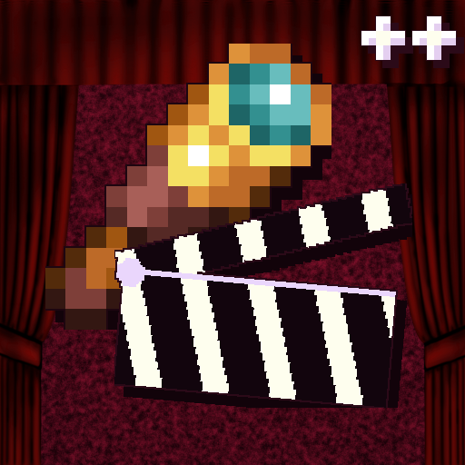

# Cinematic Zoom Extended

[](https://modrinth.com/mod/cinematic-zoom-extended)
[](https://github.com/simply-sunny/CinematicZoom-Extended/releases)
[](LICENSE)
[](https://modrinth.com/mod/cinematic-zoom-extended/versions)

Smooth, cinematic zoom for **Fabric 1.20.1–26.3**, with animated black bars, per-frame easing, two independent zoom profiles, ultra-wide zoom, snap targets, and granular HUD control.

<p align="center"></p>

## About this fork

Cinematic Zoom Extended is a fork of [Cinematic Zoom (Fabric)](https://modrinth.com/mod/cinematic-zoom-fabric) by [Mel1x](https://github.com/mel1x), which in turn is a Fabric implementation of the original [Cinematic Zoom](https://www.curseforge.com/minecraft/mc-mods/cinematic-zoom) concept by [KubePixel](https://www.curseforge.com/members/kubepixel/projects).

The fork adds separate cinematic and regular zoom profiles, configurable easing and timing, sensitivity scaling, view-bobbing removal, live bar adjustment, ultra-wide zoom, snap/magnetize targets, discrete wheel stepping, and independent HUD/crosshair/hand hiding. It is published as a separate project with Mel1x's permission in [PR #8](https://github.com/mel1x/CinematicZoom/pull/8#issuecomment-6139411837).

**This project is not affiliated with or endorsed by KubePixel or Mel1x.**

> **Migrating from Cinematic Zoom 1.3?** Keep only one Cinematic Zoom build in `mods` — Extended replaces the original `cinematiczoom-*.jar`, and both cannot load together. Your existing `config/cinematiczoom.json` is read and migrated automatically.

## Features

- **Two independent profiles**
  - **Cinematic Zoom** — black bars, optional cinematic camera, and bar controls.
  - **Regular Zoom** — the same smooth zoom without bars.
  - Each profile has its own keybind, starting zoom, in/out duration, easing curves, toggle mode, magnetize/snap settings, and HUD options.
- **Per-frame smoothing** with six easing curves.
- **Animated black bars**, adjustable live with the arrow keys.
- **Mouse-wheel zoom** — continuous or discrete steps.
- **Ultra-wide zoom** — scroll below 1× down to 0.5×.
- **Snap/magnetize targets** — zoom factors or FOV values.
- **Sensitivity scaling** — mouse sensitivity follows the zoom level.
- **View-bobbing removal** while zooming.
- **Granular HUD control** — hide the HUD, crosshair, and first-person hands independently.
- **Client-side only** — no server installation required.
- **Cloth Config and Mod Menu** settings screen, with English and Russian translations.
- **Config migration** from Cinematic Zoom 1.3.
- **First-run config import** from Zoomify, Ok Zoomer, Just Zoom, and other zoom-mod configs.

## Supported versions

| Minecraft | Build target | Java | Cloth Config |
| --- | --- | --- | --- |
| 1.20.1 | `1.20.1` | 17+ | 11.1.136+ |
| 1.21.1 | `1.21.1` | 21+ | 15.0.140+ |
| 1.21.2–1.21.4 | `1.21.2` | 21+ | 16.0.143+ |
| 1.21.5–1.21.6 | `1.21.5` | 21+ | 18.0.145+ |
| 1.21.7–1.21.8 | `1.21.7` | 21+ | 19.0.147+ |
| 1.21.9–1.21.11 | `1.21.11` | 21+ | 20.0.149+ |
| 26.1–26.1.2 | `26.1` | 25+ | 26.1.154+ |
| 26.2–26.2.2 | `26.2` | 25+ | 26.2.155+ |
| 26.3 | `26.3` | 25+ | 26.3.159+ |

All ports live on `main`. The Gradle build shares the common logic and adds only the API-specific classes required by each Minecraft version. Use the latest Fabric Loader for your Minecraft version.

## Requirements

| Requirement | Notes |
| --- | --- |
| **Fabric Loader** | Latest for your Minecraft version. |
| **Fabric API** | Matching your Minecraft version. |
| **Cloth Config** | **Required.** See the minimums above. |
| **Java** | 17 for 1.20.1, 21 for 1.21.x, 25 for 26.x. |
| **Mod Menu** | **Required.** Adds the in-game settings entry. |

The mod is client-side only. Servers do not need it installed, and it works in singleplayer and on multiplayer servers.

## Installation

1. Install **Fabric Loader**, **Fabric API**, **Cloth Config**, and **Mod Menu** for your Minecraft version.
2. Put the matching `cinematiczoom-extended-<minecraft>-1.0.0.jar` in your `mods` folder.
3. Keep only one Cinematic Zoom build in `mods`: Extended replaces the original, and the two cannot run together.
4. Launch the game.

If you are upgrading from Cinematic Zoom 1.3, keep your existing `config/cinematiczoom.json`. Extended reads the old keys and migrates them on first launch.

## Usage

| Action | Default key |
| --- | --- |
| Cinematic Zoom (hold or toggle) | `C` |
| Zoom without bars | Unbound — bind it in Controls |
| Increase bar size | `↑` |
| Decrease bar size | `↓` |

All keys are rebindable under **Options → Controls → Key Binds → Cinematic Zoom**.

- By default, hold the zoom key to zoom in and release it to return smoothly.
- Enable **Toggle zoom** in either profile to press once to zoom in and press again to zoom out.
- The **Regular Zoom** key is unbound by default so it does not conflict with the cinematic key.
- While cinematic zoom is active, `↑` and `↓` adjust the black bar height. Enable **Remember bar size adjustments** to save the new height as the default.
- While zooming, use the mouse wheel to fine-tune the zoom level (if **Mouse wheel during zoom** is enabled).
- With **Ultra-wide zoom** enabled, keep scrolling backwards past 1× to reach 0.5×.
- Zoom and overlays are automatically disabled while a GUI screen is open.

## Configuration

The config file is created at:

- **Windows:** `%appdata%\.minecraft\config\cinematiczoom.json`
- **macOS:** `~/Library/Application Support/minecraft/config/cinematiczoom.json`
- **Linux:** `~/.minecraft/config/cinematiczoom.json`

Open **Mod Menu → Cinematic Zoom Extended → Settings**, or edit the JSON file and restart the game.

### Importing settings from other zoom mods

On first launch, if `cinematiczoom.json` does not exist, Extended scans the `config` folder for zoom-mod configs and imports the settings it recognizes:

- **Zoomify** — `config/zoomify.json`: zoom amount, in/out times and curves, toggle mode, sensitivity, view bobbing, cinematic camera, scroll zoom, and secondary zoom.
- **Ok Zoomer** — `config/ok_zoomer/config.toml` or a legacy `okzoomer.json`: transition times and curves, crosshair, view bobbing, sensitivity, cinematic camera, zoom mode, and scroll zoom.
- **Just Zoom** — `config/justzoom/config.json`: base zoom, animation durations, sensitivity, smooth camera, hands, and HUD visibility.
- **Any other zoom config** — any JSON or TOML file whose path contains `zoom`, matched by key name.
- **WI Zoom / Logical Zoom** — store no config file; their zoom is built in, so there is nothing to import.

Existing `cinematiczoom.json` files are never overwritten. To re-run the import, delete `config/cinematiczoom.json` and relaunch.

<details>
<summary><strong>Full configuration reference</strong></summary>

### Cinematic Zoom profile

| JSON key | Default | Range / values | Description |
| --- | --- | --- | --- |
| `cinematicStartingZoom` | `3.0` | 1×–30× (0.5×–30× with ultra-wide) | Zoom factor applied when cinematic zoom starts. Set `1.0` to show the bars without zooming. |
| `cinematicBarsPercent` | `15.0` | 0–50 | Height of **each** black bar as a percentage of screen height. `0` disables the bars. |
| `arrowKeysAdjustBars` | `true` | `true` / `false` | Allow `↑`/`↓` to change the bar height while cinematic zoom is active. |
| `barAdjustStep` | `1.0` | 0.1–10.0 | Bar height change per tick, in percent. |
| `smoothBarChange` | `true` | `true` / `false` | Animate bar height changes instead of snapping instantly. |
| `preserveBarAdjustment` | `false` | `true` / `false` | Save arrow-key bar adjustments as the new default. |
| `cinematicZoomInMs` | `240` | 0–5000 | Zoom-in duration in milliseconds. `0` is instant. |
| `cinematicZoomOutMs` | `240` | 0–5000 | Zoom-out duration in milliseconds. `0` is instant. |
| `cinematicZoomInCurve` | `EXPONENTIAL` | `EXPONENTIAL`, `EASE_OUT`, `EASE_IN`, `EASE_IN_OUT`, `LINEAR`, `SINE` | Easing curve used when zooming in. |
| `cinematicZoomOutCurve` | `EXPONENTIAL` | Same as above | Easing curve used when zooming out. |
| `cinematicHideHud` | `true` | `true` / `false` | Hide the hotbar, health, and status effects while zoomed. Also hides the F3 overlay. |
| `cinematicHideCrosshair` | `true` | `true` / `false` | Hide the crosshair while zoomed. |
| `cinematicHideHands` | `true` | `true` / `false` | Hide first-person hands and held items while zoomed. |
| `cinematicCamera` | `true` | `true` / `false` | Use the smooth cinematic camera while zoomed. |
| `cinematicScaleSensitivity` | `true` | `true` / `false` | Scale mouse sensitivity down proportionally with the zoom level. |
| `cinematicRemoveBobbing` | `true` | `true` / `false` | Disable view bobbing while zoomed. |
| `cinematicToggle` | `false` | `true` / `false` | Toggle zoom on key press instead of holding. |
| `cinematicMagnetize` | `false` | `true` / `false` | Make the mouse wheel step strictly between the configured snap targets. |
| `cinematicSnapPoints` | `""` | Comma-separated values | Target zoom factors or FOV values. See [Snap targets](#snap-targets). |

### Regular Zoom profile

| JSON key | Default | Range / values | Description |
| --- | --- | --- | --- |
| `regularStartingZoom` | `3.0` | 1×–30× (0.5×–30× with ultra-wide) | Zoom factor applied when regular zoom starts. |
| `regularZoomInMs` | `240` | 0–5000 | Zoom-in duration in milliseconds. |
| `regularZoomOutMs` | `240` | 0–5000 | Zoom-out duration in milliseconds. |
| `regularZoomInCurve` | `EXPONENTIAL` | Six curves (see above) | Easing curve used when zooming in. |
| `regularZoomOutCurve` | `EXPONENTIAL` | Six curves (see above) | Easing curve used when zooming out. |
| `regularHideHud` | `true` | `true` / `false` | Hide the HUD while zoomed. |
| `regularHideCrosshair` | `true` | `true` / `false` | Hide the crosshair while zoomed. |
| `regularHideHands` | `true` | `true` / `false` | Hide hands and held items while zoomed. |
| `regularCinematicCamera` | `false` | `true` / `false` | Use the smooth cinematic camera while zoomed. |
| `regularScaleSensitivity` | `true` | `true` / `false` | Scale mouse sensitivity with the zoom level. |
| `regularRemoveBobbing` | `true` | `true` / `false` | Disable view bobbing while zoomed. |
| `regularToggle` | `false` | `true` / `false` | Toggle zoom on key press instead of holding. |
| `regularMagnetize` | `false` | `true` / `false` | Make the mouse wheel step between snap targets. |
| `regularSnapPoints` | `""` | Comma-separated values | Target zoom factors or FOV values. |

### General and wheel

| JSON key | Default | Range / values | Description |
| --- | --- | --- | --- |
| `mouseWheelEnabled` | `true` | `true` / `false` | Adjust the zoom level with the mouse wheel while zooming. |
| `discreteScroll` | `false` | `true` / `false` | Step the zoom by fixed increments per wheel notch instead of continuously. |
| `discreteScrollStep` | `1.0` | 0.1–5.0 | Zoom-factor increment per notch in discrete mode. |
| `allowUltrawide` | `false` | `true` / `false` | Allow scrolling below 1× down to 0.5× for an ultra-wide view. |
| `wheelStep` | `0.05` | 0.01–0.25 | Continuous wheel sensitivity. **JSON only** (not shown in the settings screen). |
| `minZoomMultiplier` | `0.0333` (1/30) | 0.01–1.0 (0.01–2.0 with ultra-wide) | Advanced: lower values allow more zoom. The maximum zoom factor is `1 / minZoomMultiplier`. **JSON only.** |

`maxZoomMultiplier` is derived automatically: `1.0` normally, `2.0` when ultra-wide is enabled.

### Snap targets

`cinematicSnapPoints` and `regularSnapPoints` accept comma-separated values:

- `2x`, `4x`, `8x` — zoom factors.
- `30fov`, `45deg`, `60°`, `70f` — camera FOV values.
- Plain numbers below `20` are treated as zoom factors (`5` = 5×).
- Plain numbers `20` or above are treated as FOV values (`45` = 45° FOV).

Out-of-range and invalid values are ignored. Enable **Magnetize zoom targets** to make the wheel step strictly between the parsed targets.

</details>

## Migrating from Cinematic Zoom 1.3

1. Keep only one Cinematic Zoom build in `mods` — Extended replaces the original `cinematiczoom-*.jar`.
2. Install `cinematiczoom-extended-<minecraft>-1.0.0.jar`.
3. Keep `config/cinematiczoom.json` — it is migrated automatically.

Extended uses a new mod ID so the loader can tell the two projects apart, but it deliberately keeps the same config file name for a seamless migration. The following legacy keys are mapped on first load:

`startingZoom`, `baseZoomMultiplier`, `barsPercent`, `smoothMs`, `hideHudDuringZoom`, `enableCinematicCamera`, `toggleMode`, and the old `minZoomMultiplier`.

If you want to start fresh, delete `config/cinematiczoom.json` before launching. A new file with defaults is created.

## Compatibility

- **Client-side only.** No server component.
- **Not compatible with the original Cinematic Zoom.** The two mods modify the same camera/FOV behavior, and Extended declares the original as incompatible so the loader shows a clear error instead of double-zooming.
- **Other zoom mods** (Zoomify, Ok Zoomer, Just Zoom, Logical Zoom, etc.) may conflict with FOV handling. Do not install more than one zoom mod; Extended can import their settings on first launch instead.
- **Sodium, Iris, and shader packs** have no known conflicts because the mod only adjusts FOV and renders a HUD overlay. They are not specifically tested in 1.0.0; report issues with exact versions.
- **OptiFine** is not supported. Use the Fabric-native equivalents.
- **Quilt** is not officially tested; use the Fabric build at your own risk.
- **Cloth Config and Mod Menu** are required.

## Troubleshooting

| Problem | Fix |
| --- | --- |
| `Mod cinematiczoom_extended requires cloth-config2` | Install Cloth Config for your Minecraft version. |
| `Mod cinematiczoom_extended requires modmenu` | Install Mod Menu for your Minecraft version. |
| `Mod cinematiczoom_extended is incompatible with cinematiczoom` | Keep only one Cinematic Zoom jar in `mods`. |
| Game crashes on launch with a Java error | Check the Java version in the table above. 26.x requires Java 25. |
| Zoom key does nothing | Bind **Cinematic Zoom** under Controls. The regular zoom key is unbound by default. |
| Regular zoom key does nothing | Bind **Zoom (no bars)** under Controls. |
| Mouse wheel does not zoom | Enable **Mouse wheel during zoom** and hold the zoom key first. |
| Bars do not appear | Use the cinematic key, and make sure **Black bars height** is above 0. |
| F3 overlay disappears while zooming | Turn off **Hide HUD** (the debug overlay follows the HUD hiding setting). |
| Settings screen missing | Install both Mod Menu and Cloth Config. |
| Broken or outdated config | Delete `config/cinematiczoom.json` and relaunch. |

Logs are in `.minecraft/logs/latest.log`. Include the log, Minecraft version, mod version, and Fabric Loader version when reporting an issue.

## Building from source

The full build requires **JDK 25** because the 26.x targets use Java 25 bytecode. Minecraft 1.20.1 is compiled with `--release 17`; the 1.21.x targets use `--release 21`.

Build every supported version and run the regression suite:

```bash
./gradlew clean test buildAll
```

On Windows:

```powershell
.\gradlew.bat clean test buildAll
```

The nine release JARs are collected in `build/libs/`:

```text
cinematiczoom-extended-1.20.1-1.0.0.jar
cinematiczoom-extended-1.21.1-1.0.0.jar
cinematiczoom-extended-1.21.2-1.21.4-1.0.0.jar
cinematiczoom-extended-1.21.5-1.21.6-1.0.0.jar
cinematiczoom-extended-1.21.7-1.21.8-1.0.0.jar
cinematiczoom-extended-1.21.9-1.21.11-1.0.0.jar
cinematiczoom-extended-26.1-1.0.0.jar
cinematiczoom-extended-26.2-1.0.0.jar
cinematiczoom-extended-26.3-1.0.0.jar
```

Build one target while developing:

```bash
./gradlew :1.20.1:build
./gradlew :1.21.7:build
./gradlew :26.2:build
./gradlew -PonlyTarget=26.3 :26.3:build
```

The headless regression suite runs against the shared zoom/config logic:

```bash
./gradlew test
```

### Project layout

- `src/common` — shared game-independent zoom, config, curve, and snap logic.
- `src/main/resources` — assets and translations shared by every target.
- `src/legacy` — shared Yarn-based code for Minecraft 1.20.1–1.21.11.
- `src/legacy-pre-1.21.11` — key-binding API used before 1.21.9.
- `src/legacy-double-fov` / `src/legacy-float-fov` — FOV signature variants.
- `src/legacy-render-tick-counter` — HUD render API used by 1.21.x.
- `src/modern` — shared unobfuscated API code for Minecraft 26.x.
- `src/modern-pre-26.3`, `src/modern-26.3`, `src/modern-post-26.1` — version-specific key input and HUD/camera code.
- `versions/<version>` — metadata and version-specific classes for each build target.
- `tests` — headless regression checks and loader/game stubs.
- `build.gradle` — the version/dependency matrix and all build configuration.

## Credits

- **KubePixel** — original Cinematic Zoom concept and Forge mod.
- **Mel1x** — upstream Fabric implementation and the 1.3 base.
- **simply-sunny** — Extended features, dual profiles, tests, and this release.
- **ColoredChromium** — velvet curtain texture used in the icon ([CC BY 3.0](https://creativecommons.org/licenses/by/3.0/)).

Published as a separate project with Mel1x's permission ([PR #8](https://github.com/mel1x/CinematicZoom/pull/8#issuecomment-6139411837)). Not affiliated with or endorsed by KubePixel, Mel1x, Mojang Studios, or Microsoft.

## License

The mod code and original assets are MIT — see [LICENSE](LICENSE). The original work is copyright © 2025 Melix; changes are copyright © 2026 Saunak Karnati (simply-sunny).

The project icon incorporates a velvet curtain texture by [ColoredChromium](https://www.deviantart.com/coloredchromium/art/Curtains-Red-Transparency-Light-424984584), licensed under [CC BY 3.0](https://creativecommons.org/licenses/by/3.0/). That texture remains under CC BY 3.0; the icon may be reused under the same terms. Minecraft is a trademark of Mojang Studios.
